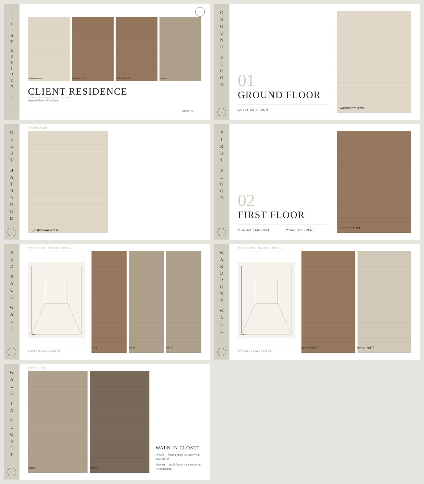

# Interior Presentation — a Claude skill

Turn a folder of reference images into an interior design concept board (HTML + PDF, 16:9 slides). There's a beige sidebar with the slide title in spaced vertical letters, your logo on every slide, plans or sketches in a left panel, and reference images in a grid. Each folder becomes a slide.



## Three ways to use it

| | Who it's for | How |
|---|---|---|
| **In the browser** | Anyone. Nothing to install | Open **[rehansqazi.github.io/interior-presentation-skill](https://rehansqazi.github.io/interior-presentation-skill/)**, drop your project folder, click *Save as PDF* |
| **With an AI agent** | Claude, Codex, Cursor, Copilot… | Install the skill (below) or point the agent at [`AGENTS.md`](AGENTS.md). The agent also checks and fixes the slides |
| **From the terminal** | Developers | `python3 interior-presentation/scripts/build_deck.py "MY PROJECT" out/` |

The browser version runs entirely on your computer, so images are never uploaded. It's a single file: [`docs/index.html`](docs/index.html).

## Folder layout

```
CLIENT RESIDENCE/
  company/
    logo main.png        # "main" in the name -> sidebar + cover
    logo partner.png     # other logos -> bottom of cover
    details.txt          # project: ..., client: ..., subtitle: ..., color: #d1cdc1
  01 GROUND FLOOR/       # top-level folder with sub-folders -> divider slide
    01 LOUNGE/
      01 FEATURE WALL/   # every folder with images = one slide
        feature wall sketch.jpg   # "sketch" / "plan" / "layout" / "elevation" -> left panel
        ref 1.jpg
        notes.txt        # optional notes column
    02 GUEST BATHROOM/
  02 FIRST FLOOR/
    01 MASTER BEDROOM/
      01 BED BACK WALL/
      02 WARDROBE WALL/
    02 MASTER BATH/
```

- Numbers at the start of folder names set the order and are removed from the titles.
- Works for one room or a whole house: nest floors → rooms → walls as deep as you like.
- Every slide shows where it sits (e.g. `FIRST FLOOR · MASTER BEDROOM`), and each floor gets a numbered divider slide.
- A PDF named `... plan.pdf` or `... sketch.pdf` is used as the plan (first page).
- Folders with more than 6 reference images are split across extra slides.

A full sample project is included in [`example/`](example/).

## Install

**Claude (claude.ai / desktop app):** zip the `interior-presentation` folder and upload it as a skill in Claude's settings.

**Claude Code:** copy `interior-presentation/` into `~/.claude/skills/`, or into `.claude/skills/` inside a project.

Then ask Claude: *"Make the presentation from the CLIENT RESIDENCE folder."*

## Run the script directly

```bash
pip install pillow playwright
playwright install chromium
# poppler (pdftoppm) is only needed for PDF plans: brew install poppler / apt install poppler-utils

python3 interior-presentation/scripts/build_deck.py "example/CLIENT RESIDENCE" out/
```

This writes `out/CLIENT RESIDENCE PPT.html` and `out/CLIENT RESIDENCE PPT.pdf`. Images are embedded, so the HTML file works on its own.

## License

MIT
